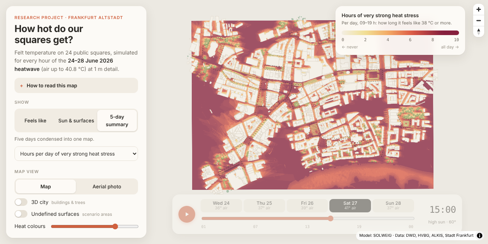

# Urban Heat Stress – Frankfurt Platz

**How hot does it feel on Frankfurt's public squares during a heatwave — and where would design help most?**



This research project simulates outdoor thermal comfort on Frankfurt's squares (*Plätze*) at **1 m × 1 m** resolution, hour by hour, using the physically based radiation model **SOLWEIG** (UMEP). The pilot covers 24 squares in the Altstadt / Innenstadt during the **24–28 June 2026 heatwave** (DWD Frankfurt/Main station: air temperature up to 40.8 °C, five tropical nights in a row).

The results are published as an interactive map (`docs/`, served via GitHub Pages):

* a **timeline player** through every hour of the heatwave (times shown in summer time, CEST);
* **felt temperature (UTCI)** with the five official heat-stress classes, **radiant heat (Tmrt)** and five-day summary maps;
* a **3D city**: ALKIS buildings extruded to their roof height (DOM1 − DGM1) and every registered street tree drawn from its height and crown diameter, over a map or Hessen's 20 cm aerial photo;
* a ranking of squares by heat stress, with an hourly profile and a short explanation for each square.

> **Scope.** This is an independent research project built entirely from openly available data. It shows what can be learned from these data, not a complete picture: some factors are missing or simplified (see *Limitations*), and results should be read as an informed estimate, not as official measurements.

> Status: pilot (Altstadt). Next: an in-browser design sandbox (add trees / change surfaces → approximate ΔTmrt, calibrated against SOLWEIG) and extension to all 98 squares in central Frankfurt.

---

## Method

| Step | Script | What it does |
|---|---|---|
| 1 | `pipeline/01_prepare_inputs.py` | Builds the model inputs for the pilot area: DSM (DGM1 + DOM1 inside ALKIS building footprints), relative canopy height (CDSM), a complete land-cover grid, square outlines, and the heatwave weather file. |
| 2 | `pipeline/02_run_solweig.py` | Runs SOLWEIG for 23–28 June 2026 (23 June = spin-up, discarded) and writes hourly Tmrt, UTCI and shadow rasters. Includes a sanity check that open squares are sunlit at midday. |
| 3 | `pipeline/03_plaza_stats.py` | Five-day summary rasters and per-square statistics (hours/day at UTCI ≥ 38 °C and ≥ 32 °C, peak Tmrt, sun share, night UTCI, tree and surface shares). |
| 4 | `pipeline/04_export_web.py` | Encodes hourly frames as 8-bit PNGs; exports 3D buildings and trees and everything else the web viewer needs to `docs/data/`. |

Run everything with `python pipeline/run_all.py` (see *Reproduce* below).

### Inputs

| Layer | Source | Notes |
|---|---|---|
| Terrain (DGM1) | HVBG Hessen, 1 m | absolute elevation |
| Surface model (DOM1) | HVBG Hessen, 1 m | used only inside ALKIS building footprints (nDSM ≥ 2.5 m) |
| Buildings | ALKIS Hessen | footprints; underground structures (`rellage` = *Unter der Erdoberfläche*, e.g. car parks below squares) excluded |
| Trees | Frankfurt tree register (Baumkataster) → canopy raster, 1 m | relative height; 0 = no tree. Viewer: trunk + crown from height and crown diameter |
| Surfaces | own mapping of square surfaces (UMEP classes) | + buildings (2), Main river (7, from DGM1 water level), default paving (0) |
| Squares | ATKIS/ALKIS `AX_Platz` | 100 m buffer = model domain |
| Aerial photo (viewer only) | HVBG Hessen DOP20 WMS (`he_dop20_rgb`) | basemap; not a model input |
| Weather | DWD station 01420 (Frankfurt/Main airport), hourly 2026, provisional | T, RH, wind, global & diffuse radiation |

### Model settings
SOLWEIG (umep-dev `solweig` 0.1.0b96), anisotropic sky, standing person (absorption 0.70 shortwave / 0.97 longwave), deciduous trees (transmissivity 0.03 leaf-on), trunk ratio 0.25, location Römerberg (50.111 N, 8.682 E), weather in local standard time (CET, UTC+1).

### Indicators
* **Tmrt** — mean radiant temperature: the combined effect of sun, sky and surrounding surfaces on a person.
* **UTCI** — Universal Thermal Climate Index: "felt" temperature. Classes: 26–32 moderate, 32–38 strong, 38–46 very strong, ≥ 46 °C extreme heat stress.
* **Hours/day at UTCI ≥ 38 °C** (09–19 h CEST) — main ranking indicator. In this heatwave UTCI exceeds 32 °C even in the shade for most of the day, so the 32 °C count barely separates the squares.

### Limitations
* Weather data are **provisional** and come from the airport station, not the city centre. Air temperature and wind are applied uniformly; the urban air-temperature excess and the lower wind speeds in enclosed squares are not modelled, so felt temperatures are **likely conservative (underestimated)**. Spatial differences are driven by radiation: sun, shade, sky view and surfaces.
* **Radiation timing correction.** In the provisional EPW the radiation columns are labelled in DWD true solar time (WOZ) but were processed as UTC, which puts them ~32 min late relative to the sun (verified against a clear-sky curve on 24–27 June: best fit shifted from −40 min to ≈0 min after correction). `01_prepare_inputs.py` re-bins GHI/DNI/DHI by this lag (`RAD_WOZ_FIX` in `config.py`). To be replaced by a clean conversion from raw DWD files.
* Shadows are cast up to 500 m (`MAX_SHADOW_M`) instead of SOLWEIG's default 1000 m to keep the domain in one tile; at 14:00 this changes Tmrt by more than 1 K on ~9 % of square pixels (mean −0.2 K).
* SOLWEIG's modelled downwelling longwave carries a known positive bias (+18 to +55 W/m²; see the SOLWEIG validation notes).
* Results are not validated against field measurements in Frankfurt.
* Not captured with the available data: temporary shade (awnings, umbrellas, market stalls), fountains and water features, private and courtyard trees, green roofs and façades, and the exact material and colour of every surface.
* Trees come from the municipal register; private trees and green roofs/façades are not included.
* Outlines of squares without an exact ALKIS polygon were reconstructed from their 100 m buffer (marked in the viewer).
* Surface classes 3, 4, 8, 9, 10 in the surface mapping are not defined in SOLWEIG; they are modelled as paving and shown as *scenario areas*.

---

## Reproduce

```bash
python -m venv .venv && source .venv/bin/activate
pip install -r requirements.txt
python pipeline/run_all.py            # all four steps
# on Apple Silicon you can use the GPU:  SOLWEIG_CPU=0 python pipeline/run_all.py
```

The scripts expect the source data in the parent folder (`1_SHP Files/2_Raster`, `3_SHPs`, `5_SOLWEIG`); set `FFM_ROOT` to point elsewhere. Large rasters are written to `outputs/` (git-ignored). Preview the site locally with `python -m http.server -d docs` and open http://localhost:8000.

## Repository layout

```
pipeline/   Python pipeline (config + 4 steps)
data/       small derived data: square outlines, statistics, hourly time series
docs/       static web viewer (GitHub Pages root) + encoded frames in docs/data/
outputs/    model inputs, SOLWEIG cache and hourly rasters (not in git)
```

## Data sources & licences

| Data | Provider | Status / period | Licence | Attribution |
|---|---|---|---|---|
| Hourly weather, station 01420 Frankfurt/Main | Deutscher Wetterdienst, [Open Data CDC](https://opendata.dwd.de/climate_environment/CDC/) | 1 Mar – 31 Aug 2026, provisional | [CC BY 4.0](https://creativecommons.org/licenses/by/4.0/) (GeoNutzV) | *Datenbasis: Deutscher Wetterdienst, eigene Bearbeitung* |
| DGM1, DOM1 (1 m), DOP20, ALKIS buildings, ATKIS Basis-DLM squares | Hessische Verwaltung für Bodenmanagement und Geoinformation (HVBG), [gds.hessen.de](https://gds.hessen.de) | retrieved 22 Oct 2026; ALKIS up to 30 Sep 2026, AX_Platz up to 24 Apr 2026 | [dl-de/zero-2-0](https://www.govdata.de/dl-de/zero-2-0) | *Geobasisdaten © Hessische Verwaltung für Bodenmanagement und Geoinformation* (voluntary) |
| Tree register (Baumkataster) | Stadt Frankfurt am Main, [OffeneDaten Frankfurt](https://offenedaten.frankfurt.de) | retrieved 22 Oct 2026; plantings up to 2024 | dl-de/by-2-0 (check the dataset page) | *Baumkataster © Stadt Frankfurt am Main* |
| Basemap | [CARTO](https://carto.com/attribution), [OpenStreetMap](https://www.openstreetmap.org/copyright) contributors | live | free for non-commercial use with attribution | *© CARTO, © OpenStreetMap contributors* |
| Surface materials of the squares | own mapping (B. Parlatangiller) | Oct 2026 | CC BY 4.0 | — |

Software: SOLWEIG / UMEP (Lindberg et al. 2008, 2016; Wallenberg et al. 2025), QGIS, GeoPandas, Rasterio, NumPy, SciPy, pyproj, rasterstats, MapLibre GL JS, proj4js.

## How this was made

Research question, data acquisition and GIS preparation in QGIS (square selection, building heights, canopy raster from the tree register, surface-material mapping, weather file, first SOLWEIG runs) by the author. The Python pipeline, input checks, web viewer and publishing were developed with AI assistance (Claude, Anthropic) and reviewed by the author.

## Licence

Code: [MIT](LICENSE). Model results and derived data in `data/` and `docs/data/`: [CC BY 4.0](https://creativecommons.org/licenses/by/4.0/), together with the source attributions above.

Author: Barış Parlatangiller
